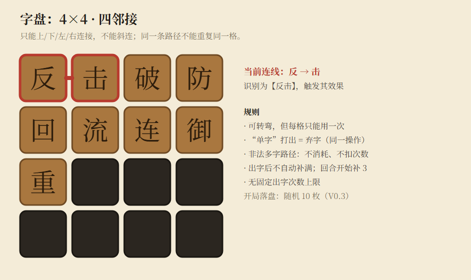
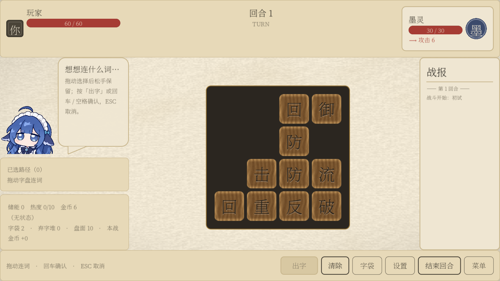
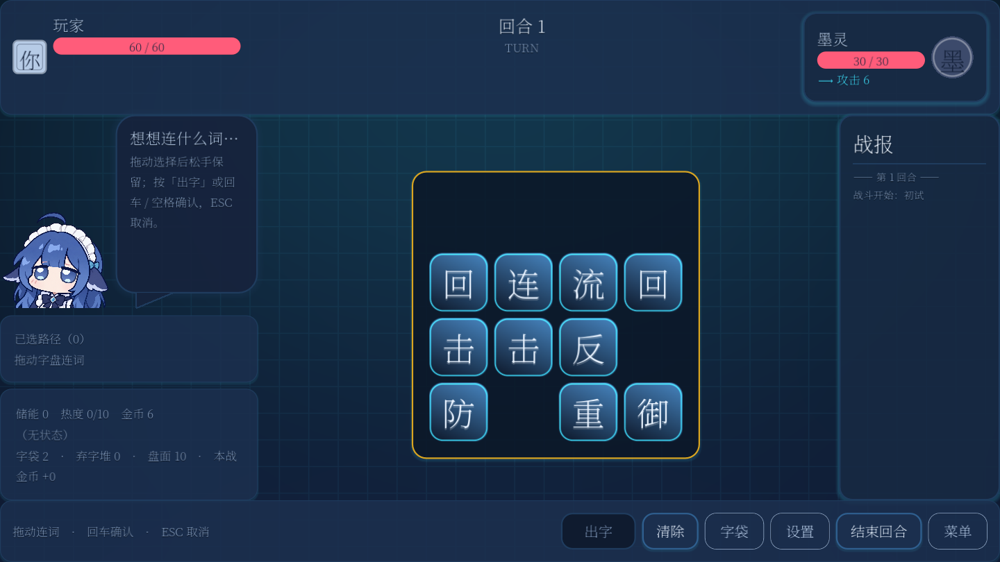
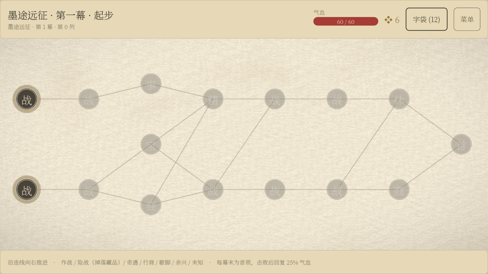

# 开发日志｜从一枚“击”开始，把组词战斗延伸成一场远征

2026年10月12日 · 《活字工厂》玩法转向与迭代记录

这次转向，始于一次和队友的交流。

当时，我们还在围绕工厂、产线和卡牌制作推进游戏。队友提出了另一种玩法：把汉字放进4×4字盘，让玩家通过连字组词进行战斗。讨论下来，我们觉得这套玩法更有趣，也更接近这次想回应的“涌现”主题，于是决定沿着这个方向继续做。

最先吸引我们的，是战斗中那些字与字之间的关系。后来才有了新的问题：如果这种组合乐趣能够成立，怎样让它从一场战斗延续到一整局游戏？从字盘战斗，到几轮地图实验，再到目前的“墨途远征”原型，这段时间的迭代始终围绕着这个问题展开。

## 1. 一枚“击”，为什么值得做成一个游戏？

*《活字战斗》原策划图：4×4字盘，只能沿上下左右连接，可以转弯，同一条路径不能重复经过同一格。*

这套战斗的基本操作很直观：在字盘上找到相邻的汉字，将它们连成词，再由词触发攻击、防御、补字或改变盘面的效果。

但真正让我们想继续做下去的，是字会被消耗。

看上图第一行的“反、击、破”：中间那枚“击”，既可以组成“反击”，也可以组成“击破”。通常情况下，先打出一个词，其中的字就会离开盘面，另一个词也随之失去条件。面对不同的敌人意图，玩家需要决定，这枚“击”现在应该拿来防反，还是用于破盾。

**玩家拥有的是一枚能参与多种关系的字。使用它，就是在几个可能的行动之间作出取舍。**

因此，字盘也不能每次出词后立刻自动补满。原策划保留了空位，回合开始通常补入3枚字，能补多少还取决于剩余空间和字袋。字少了，眼前可用的组合会减少；留下的空格，又能容纳新的字。玩家需要同时考虑这一手的收益和之后的盘面。

## 2. “涌现”发生在规则互相影响的时候

单纯增加词的数量，并不能自动带来我们想要的涌现。更有意思的是：一个词的效果，会改变另一个词成立或使用的条件。

例如，“回流”能够补字，旋转、反转与重力能够改变位置。原本隔开的字，可能因此连在一起；原本可用的路径，也可能被自己的一次操作拆开。玩家每出一手，都在重新组织下一手的可能性。

策划案还设计了改变出词规则的能力。“重合”让同一格获得额外的临时使用层，“重复”让之后每回合第一次有效多字词的即时效果再执行一次。于是，先启动能力还是先打伤害、把额外使用机会留给哪个字，都开始影响后续的选择。需要支付的资源仍然要支付，额外触发并不意味着没有代价。

热度则把这种关系进一步串成了循环。

“加速”让本回合每次打出多字词后额外补1字，同时增加1热度。新字可能带来下一次出词的机会，但继续行动也会让热度逼近热容。热度溢出后，带灼热的“热”会进入本场字袋，之后再次抽到、打出时，就可能损失生命。

而“火爆”可以把热度消耗掉，转成伤害；“冷却”可以主动降温。同一份热度，既能成为危险，也能成为下一次攻击的材料。玩家要根据当前能连出的词、剩余空位和敌人的行动，决定继续加速、把热度兑现成伤害，还是先降低风险。

**我们希望涌现出来的，是玩家在具体局面中找到的行动路线。** 词库和词效由我们设计，但位置、字袋、出招顺序、资源与敌人状态叠在一起后，未必只有一种解法。这也是队友的方案最吸引我们的地方：字之间的关系可以不断变化，玩家能够从中发现自己的用法。

当然，这仍是需要验证的方向。如果最后每场战斗都只剩同一套最优连招，那么词再多，也没有真正形成丰富的选择。

## 3. 让这些关系在屏幕上看得懂

*依据同一份策划案完成的另一套 Godot 实现，保留了纸面三栏布局：玩家资源、中央字盘、敌方意图与战报。图中选中的是“回击”。*

战斗落地之后，界面也经历了多轮调整。我们需要让玩家看见自己选了什么、会消耗什么，以及这一手会产生怎样的结果。

现存的实现记录里，有两套基于同一份策划案展开的 Godot 工程：队友的原工程持续迭代战斗与表现；另一套独立实现尝试了纸面三栏布局，并补齐字袋、词典、奖励、商店和试字沙盘等界面。它们提供了不同的呈现方式，也留下了可以互相比较的实际画面。

原工程随后加入了“宣纸活字”和“墨芯”两套可切换主题。前者强调纸张、木质活字和印刷感，后者尝试网格背景与发光字块。视觉风格在变化，字盘始终是主要的操作区域。

*原工程当前保留的宣纸主题：木质字块、独立字盘舞台，以及左侧的角色反馈和路径区。*

*同一工程中的墨芯主题。两张画面展示已实现的两种风格，均为当前版本补拍。*

比换主题更关键的，是信息的位置和操作顺序。

第二轮战斗界面把玩家、回合与敌人的信息移到顶部；左侧用气泡承接词效预览和结算反馈，再用路径条展示已经选中的字。这样，选字、看效果、判断敌方意图，不必都挤在同一块区域里。

之后，角色图与短暂的无效词反馈加入界面，部分操作也统一到了“发动”这一步。例如“合击”逐渐发展成先登记多个词，再一起结算的交互：玩家需要先看清组合，再确认执行。这个改动既涉及玩法，也要求界面能表达尚未结算的行动。

再往后，迭代开始集中到出招的表现：震动、顿帧、伤害数字和闪白强化命中反馈，字盘舞台与字块材质则重新拉开了背景和操作对象的层次。

回看这几轮改动，UI承担的任务越来越明确：让玩家能够理解组合产生的结果，并在下一次主动运用。一次偶然成功的操作，只有被看懂，才可能变成玩家掌握的策略。

## 4. 战斗之外，怎样继续围绕“字”作选择？

原策划已经有三幕冒险、战后奖励、商店和字袋成长的框架。战后获得的字，会影响之后能组成哪些词；复制关键字可以提高某种组合出现的机会，增加新字也可能稀释原有组合。

这让成长有了一个值得继续挖掘的方向：奖励的价值取决于它与已有字的关系。一个字能接上现有词链，可能比单独看起来更强的字更有用。

*Godot版本中的“墨途远征”：沿分支路线进入战斗、事件、商店和休整节点。它与后文的拾字排版原型是两种不同的地图实现。*

围绕这套战斗，Godot工程先后保留了经典长卷、墨途远征和科场连考等大循环尝试。路线冒险与分阶段挑战，改变了玩家备战、成长和承担风险的节奏。

随后，地图探索又向前走了一步：既然汉字是核心材料，能不能让“寻找需要的字”直接成为选择路线的理由？

## 5. 从五种地图方向，走到“铺字成路”

*保存下来的地图方案页，记录了五种初始方向、后续三个排版方案，以及C2、C3两轮深化。页面按新到旧排列。*

第一轮地图实验有五个方向：把地图做成大字盘、沿字网远征、收字后排版、让地形影响战斗，以及按部首划分区域。

它们尝试连接战斗与地图的方式各不相同。大字盘和字网把“组词”放进路线；地形与部首分区改变玩家会遇到什么；排版则把一路收集的字留下来，让它们成为可以调整的构筑。

之后，排版方向继续分成了三个方案。

**自由版面**让玩家预先布置字盘，再把它用于战斗开局；**词即前路**尝试让排出的词决定后续站点；**铺字成路**则让玩家一边行走，一边把字放到地图上。三者分别把排版接到了战斗准备、路线生成和移动过程里。

“铺字成路”继续发展出了C2：地图加入目标字、行动资源“墨”和遭遇之间的联系。玩家每走一步都要花墨，沿途目标、补给和敌人因此有了成本上的区别。

*C2把移动和摆字放在同一张地图上：走向哪里，也会决定字留在哪里。*

这一版的联系很紧。为了组词，玩家可能改变行进方向；为了抵达目标，又要接受不那么理想的摆字位置。它带来了路线与组合之间的取舍，也留下了一个需要继续解决的问题：如果摆放位置始终受行走路径约束，收集到的新字是否还有足够的调整空间？

## 6. C3：把探索和排版拆开，再让它们互相推动

C3做出的主要变化，是保留地图上的探索与资源消耗，把摆字移到独立的6×6排版台上。玩家先沿地图寻找和收集汉字，再把字匣里的字放到排版台中，组成横向或纵向的词。

地图负责提出问题：下一步往哪里走，要为哪枚字绕路，要不要先挑战守在附近的敌人？排版台负责让玩家重新组织已经得到的材料。

*C3当前原型：“火力”和“合力”共用一枚“力”。首次组成这两个词，各返还1点墨；右侧显示首领及其周围字形成的关系。*

图中的“火力”和“合力”就是一个小例子。三枚字通过位置安排组成两个词，共用中间的“力”。首次发现新词还会返还墨，给下一段探索提供资源；已经发现过的词，拆开重摆不会重复获得奖励。

这样，寻找新字能够推动排版，新组合又能支持继续探索。玩家需要的字，开始有机会成为地图上的明确目标。

这一轮也把敌人纳入了字的关系。敌人本身是一枚字，能够与周围的字组成词，词的起始字决定归属。以首领“铸”为例，左侧的“精”可以与它组成玩家一方的“精铸”，下方的“币”则让首领组成敌方的“铸币”。挑战之前，玩家可以先观察这些关系。

后续又补上了看守规则：敌人未被击败时，它上下左右的字不能直接拾取。这让附近的字同时成为战斗关系和探索奖励，也避免了玩家通过提前拿走邻字，轻易拆掉敌方组合。

## 7. 为什么目前继续沿着C3做？

从这些方案的差异来看，C3值得继续验证的地方，是它给探索和构筑都留出了空间。

找字能够影响路线，摆字又可以在获得新材料后重新调整。一次绕路得到的收获，可以直接在排版台上变成新词或交叉结构；前一次行走的路径，也不会把后续摆法完全固定住。

这延续了最初4×4战斗中吸引我们的东西：字的价值取决于它能与什么发生关系。只是现在，我们试着把这种关系扩展到探索、收集和成长之中。

不过，C3目前仍是地图与排版原型。遭遇采用预计损血和模拟结算，尚未接入已有的4×4战斗；6×6排版也使用横竖直线识词，与战斗中的转弯连线不同。跨幕成长和完整的失败压力还需要继续补齐。

接下来最需要验证的是：自由调整排版，会不会变成每次战斗前的重复劳动？交叉组词能否形成多种可用构筑？当4×4战斗接入后，地图上选择寻找的字、付出的资源和承担的风险，是否真的能影响战斗中的决策？

这些问题决定了这套大循环能否成立。我们会继续围绕实际的选择和反馈改进，让最初在一枚“击”上看到的组合潜力，逐步延伸成一场值得反复探索的远征。

#TapTapGameJam #开发日志 #活字工厂 #墨途远征
