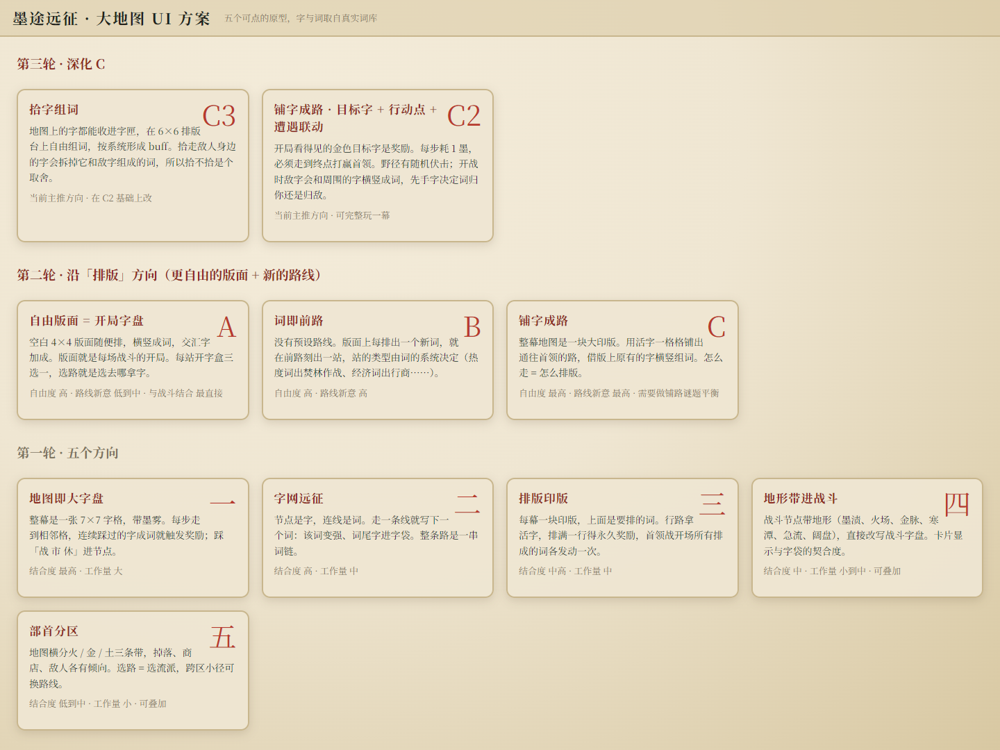
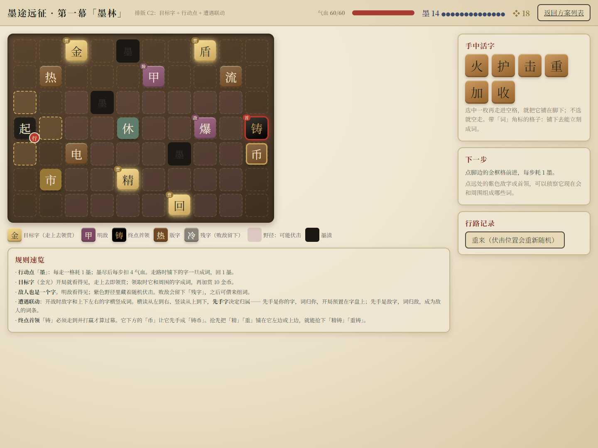

# 开发日志：从造卡的工厂，到拾字成词的远征

2026年10月12日｜《活字工厂》玩法转向记录｜当前验证原型：墨途远征 C3

这一次，我们换了玩法。

过去做《活字工厂》，我们试过让白板沿生产线经过字模、合成与外观加工，再把造出的卡送进战斗。循环逐渐跑通了，但一个问题一直没有消失：**系统在运转，玩家却未必有足够多值得犹豫的选择。**

本地的《第五次记录》里，写得很直接：“循环实现了，但是不好玩，随机性、变数、挑战难度不够高。”我们也记下过“短期承担压力，长期获得更高收益”的期待。

所以，这次没有继续沿着“再加几台机器、再补几种材料”的方向往下堆，而是重新围绕“活字”本身寻找玩法。现在正在验证的 C3，变成了一个探索地图、收集汉字，再把这些字排成词的原型。

*当前 C3 实际浏览器画面。用初始字组成交汇的“火力”和“合力”，右侧侦察首领。本图通过正常界面摆字得到，不是效果图；遭遇仍采用模拟结算。*

## 先把问题从“产线缺什么”换成“这些字还能做什么”

旧工厂方案的长处很明确：投入、加工、成品和战斗可以连成一条直观的链。但当玩家找到一条可用生产路线以后，如果地图、敌人和成长目标变化不足，后面的操作就容易变成维持产量。

这并不表示经营玩法没有价值。它提醒我们，增加内容数量和增加决策，并不是同一件事。

转向后的第一步，是已有的 Godot《活字战斗》：在4×4字盘上用相邻汉字连成词，通过词义产生攻击、防御、改盘和资源效果；战后改变字袋，影响之后能够组成什么词。

这个方向保留了“组合产生新能力”的兴趣，但组合对象更直接了。同一个“力”，遇到“火”可以成为“火力”，遇到“合”又可以成为“合力”。一个字的价值开始取决于它身边有什么，而不只是它自己的固定数值。

接下来出现的新问题是：**既然战斗里在组词，战斗之外的地图，能不能也真正围绕字来设计？**

## 第一轮：先把五种地图摆到一起看

我们没有直接确定一条路线，而是先做了五个可点的地图原型。

| 方向 | 想尝试的结合方式 |
|---|---|
| 地图即大字盘 | 沿相邻字格走，踩过的字成词后触发奖励 |
| 字网远征 | 节点是字，连接是词，整条路线形成词链 |
| 排版印版 | 沿途拿字，填入印版，组成词后得到奖励 |
| 地形带进战斗 | 墨渍、火场、金脉等地形改写战斗条件 |
| 部首分区 | 不同区域倾向不同的字、奖励和敌人 |

*本地方案索引的实际画面，保留了第一轮五个方向、第二轮 A／B／C，以及后续 C2、C3。页面按新到旧排列，正文按迭代顺序讲述。索引中的个别说明已落后于最新规则。*

这些方案让我们能具体比较：地图是在给战斗挑条件，还是自己也产生了与汉字有关的决策？玩家拿到一个字之后，是否会立即重新考虑接下来的路线？

“排版”值得继续深入，是因为它既贴合活字主题，又能把收集成果直接放到玩家眼前。拿到的新字不仅进入一个库存数字，还可以摆下来，与已有的字发生关系。

## 第二轮：排版和行路，究竟要绑得多紧？

沿着排版方向，我们又分出了三个版本。

**A：自由版面。** 玩家自由安排4×4版面，把它作为战斗开局。收字与战斗的联系直接，但地图仍然更像提供奖励的路线。

**B：词即前路。** 玩家排出的词决定接下来生成什么站点。这个版本把组词与地图生成绑定起来，路线本身也由玩家创造。

**C：铺字成路。** 整幕地图是一块印版，玩家一格格铺字通往首领，借已有的字组成词。行路和排版在同一块空间发生，结合最紧，但也需要处理路线可达性与铺字谜题之间的关系。

我们继续深化 C，并在 C2 里加入了几个明确的约束：每走一步消耗“墨”；金色目标字开局可见；野径可能遭遇伏击；必须走到终点并战胜首领才算过幕。

这些机制让路线不再只是“随便走走”。为了拿一个有用的字多走几步，是否值得？是先去歇脚，还是带着当前资源直奔首领？短期成本和长期收益，终于有了可以直接观察的承载位置。

*C2实际初始界面：手中活字用于铺路，地图同时承担移动、排字、目标奖励与敌人遭遇。它是本次迭代的前一阶段，不是当前 C3 的操作方式。*

## 第三轮：C3把“走到哪里”和“字怎么摆”分开

C3保留了地图探索，但不再要求每一步都承担铺字任务。玩家先在地图上收集字，再把它们放到独立的6×6排版台。

现在，一次探索可以这样展开：

1. 观察地图上的目标字、行商、歇脚点和敌人，决定下一步去哪里。
2. 花墨移动，走到散落的字上，选择是否收进字匣。
3. 把收来的字放到排版台，横向或纵向组成词。
4. 根据词的系统获得加成，再决定继续收集、补充墨，还是挑战敌人。
5. 战胜普通敌人后，敌字也进入字匣，成为下一次组合的材料。

这里的收集容器是“字匣”，不是已经接入完整战斗抽取循环的字袋。C3的排版识词也有明确边界：只读从左到右、从上到下连续的2至4字词，不使用 Godot 战斗中的转弯连线路径。

排版可以免费调整，点击已摆的字可以收回。三字以上的词得2点，其他词得1点；一个词包含交汇字时再加1点。热度、储能、经济、防反和流转，分别影响预计损血、战胜回墨、金币、敌方词条抵消与伏击探知。

首次组成一个新词，会回1点墨；拆开后重新摆回同一个词，不会重复领取。于是，探索拿字能帮助排版，而新词又能给下一段探索提供资源。

图中的“火力／合力”就是一个最小例子：同一个“力”既参与竖向的“火力”，又参与横向的“合力”。玩家没有拿到两份“力”，却通过位置安排让同一枚字参与了两个词。两词首次入谱，让墨从14变成16。

## 为什么目前选择继续做 C3？

从这些原型的规则差异看，C3最值得验证的地方，是它把探索与构筑接上了，同时给两者留下各自的操作空间。

**拿什么，能够影响往哪里走。** 地图上的字是看得见的目标。已有的字与缺少的字，可以成为绕路、买字和挑战敌人的理由。

**怎么摆，不再完全受走过的路线限制。** 与铺字成路相比，独立排版台允许玩家重新安排已有资源。前一步路线选择没有把后面的组合完全固定住，也更方便快速试验新词和交汇结构。

**空间组合能留下可见成果。** 一个词是否成立、哪枚字被交叉使用、它增加了哪一类点数，都能在排版台上看到。这里有机会形成比单纯累计材料更明确的“我的构筑正在成型”的感觉。

**原型验证可以更集中。** 先用模拟遭遇观察路线、收字与排版是否互相促进，再决定怎样接入正式战斗。这样可以先回答最关键的问题，而不是让战斗数值把地图设计的问题掩盖掉。

这些是对现有方案的设计判断，不是已经得到大量试玩数据支持的结论。当前选择 C3，是选择继续验证这一条主线，并不表示其他方案已经被证明不好玩。

## 敌人周围的字，也参与这场排版

C3还保留了C2的一个联动：敌人本身也是一个字，它会和地图周围的字组成词，词的第一个字决定归属。

例如首领是“铸”，左边的“精”可以与它组成“精铸”，归玩家；它下方的“币”又让它组成“铸币”，归敌人。挑战一个敌人之前，玩家可以先侦察这些关系。

最新版本也加上了看守规则：未被打败的敌人上下左右的字不能拾走。因此，不能简单地先拿走敌人旁边的字，就让威胁消失。敌方成词可以通过排版台上的防反点数抵消；打败普通敌人之后，才能收集它看守的字。

这也是C3本地文件相对早期方案说明的一次收紧。旧索引还在强调“拾走敌人旁边的字拆词”，而当前规则已经把直接拆掉敌词的办法限制住了。日志按最新原型写，不把两个阶段的规则混在一起。

## 现在已经能试什么，还没完成什么？

当前原型可以走完第一幕的探索流程，体验相邻移动、消耗墨、拾字、行商、歇脚、伏击、排版、新词奖励、敌字联动与首领模拟结算。

但**C3目前没有接入完整4×4战斗**。“开战”按钮直接按公式扣除预计损血；界面上的灼烧、偷金等敌词描述，还不是实际逐回合执行的战斗状态。

另一个重要边界是：当前墨尽移动和战斗扣血都保底1点气血。玩家可以用它继续体验机制，但这还不能验证失败压力是否合理。幕终显示的“剩余墨转金币”和“带入下一幕”，也尚未形成真正的跨幕流程。

这次实际浏览器检查确认了初始字摆放、交汇识词、首次新词回墨、重复成词不刷奖励、相邻移动消耗墨；本文配图均来自对应本地原型的真实渲染。完整冒险与数值平衡仍需另行验证。

下一步最值得问的，不是词库还能增加多少，而是：

- 排版可以随时免费修改，会不会让每次遭遇前都变成重复重排？
- 交汇收益是否足够有趣，又会不会让某种固定摆法成为唯一答案？
- 拾字、买字和绕路之间，能否形成真正不同的构筑选择？
- 当模拟损血接入正式战斗后，地图上的选择还能不能清楚地影响胜负？

从生产线到字盘，再从铺字走路到拾字排版，这几轮迭代都在尝试同一件事：让手里已有的东西，改变我们对下一步的判断。C3给出了一个更清楚的试验场，接下来就要看它能否让这种判断持续有趣。

#聚光灯gamejam开发者日志 #活字工厂 #墨途远征
