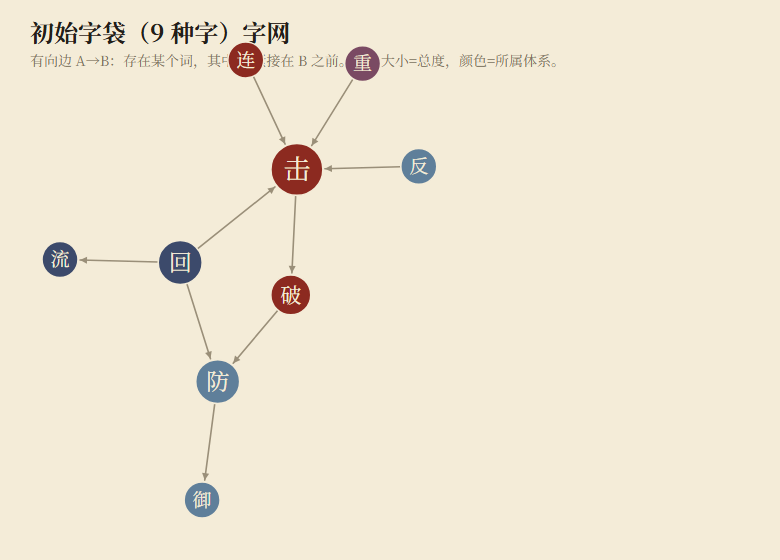
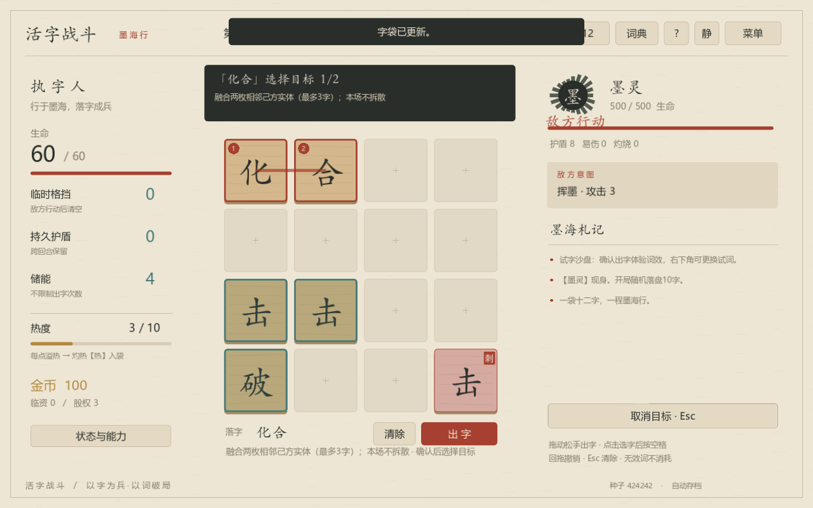
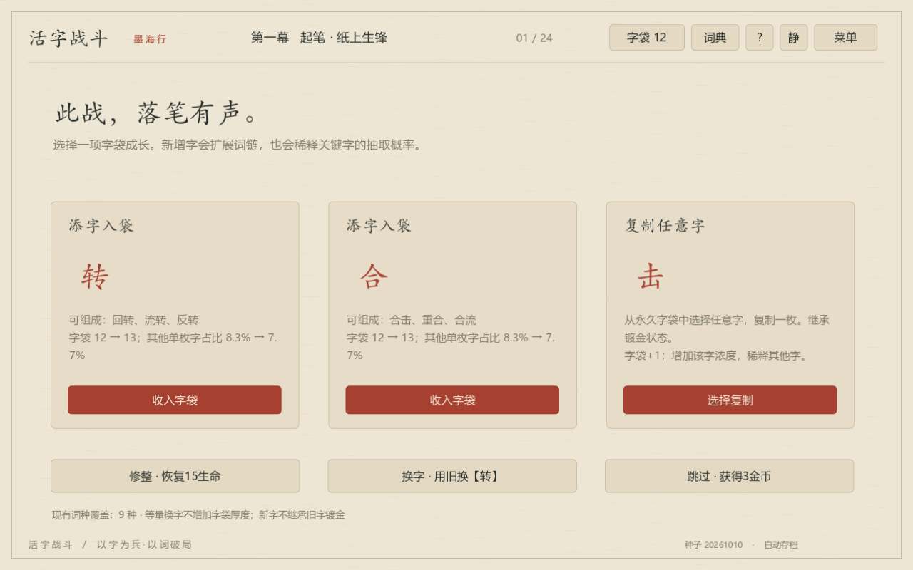
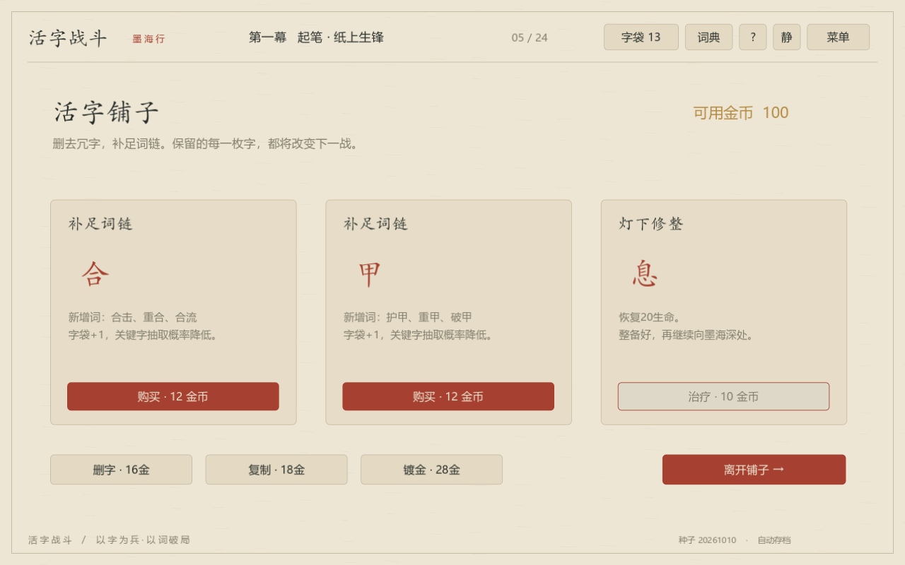
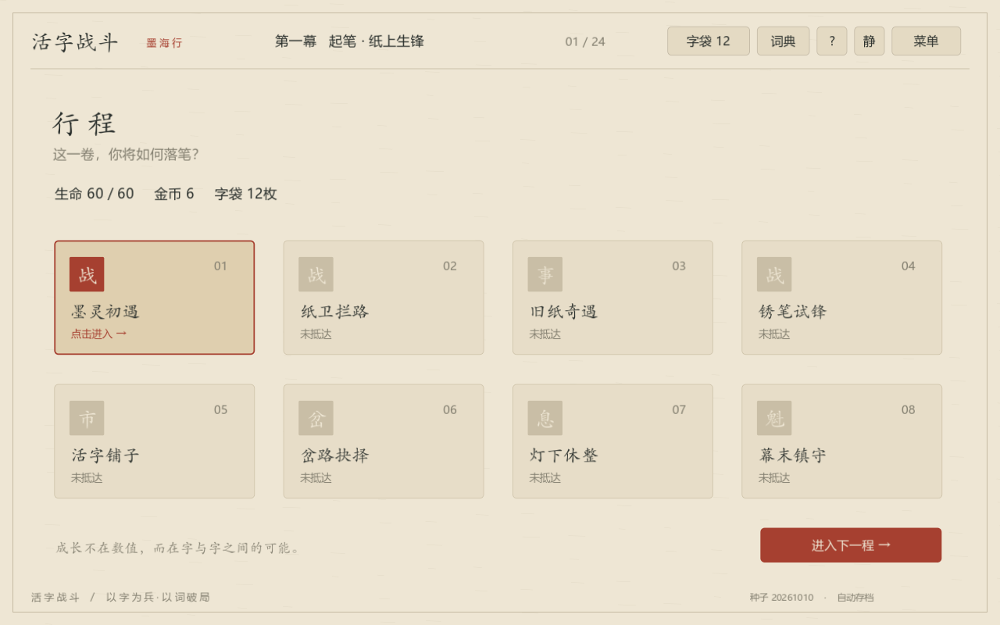
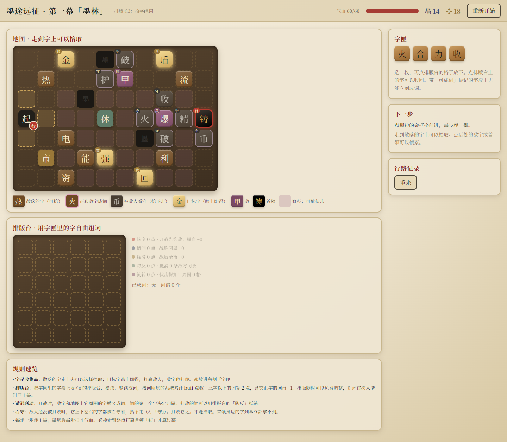

# 4×4起点、UI探索与Godot实现：溯源索引

2026年10月12日。依据用户确认的两处本地实现及修改记录整理。游戏源码未在本任务中修改或重置。

## 两个工程的关系

- huoziluandou：队友原工程，最早可核实提交 f5fe1ff（10月10日），当前已跟踪的游戏内容截至679cdd5。后续 e95216b 等为本日志的文档提交。当前Godot启动日志实际加载61字、137词，早期README/GDD中的106词应按历史口径理解。
- Huozi：根据用户在“根据策划案开发游戏”对话中提供的 GDD V1.0 独立重建，提交3a3d137。IMPLEMENTATION.md明言没有恢复原作者源码；273条逻辑断言、14条UI断言是当时记录，本次未重跑全套验收。
- prototype_c3：独立地图实验。现存Godot已有三种大循环，但C3当前并未接入4×4战斗；同名“墨途远征”不能视为同一实现。

## 初版图片能确认到哪里

原策划4×4图已找回，保存在原工程docs/images/board.png。GDD V1.0是实现对齐版，初版创意来源由用户直接说明为队友。未找到能确认属于f5fe1ff当时拍摄的独立实机截图，因此不拿Huozi截图、当前补拍或重建图冒充。原工程连续UI修改以Git提交为证，当前保留的效果用现有工程补拍说明。

## 修改记录

| 日期 | 提交 | 内容 |
|---|---|---|
| 10月10日 | f5fe1ff | Godot 4×4、106词初始实现、策划与字网 |
| 10月11日 | 8b5ceca | 拆分大类，整理协作工程 |
| 10月11日 | 9806e49 | 宣纸／墨芯主题系统 |
| 10月11日 | 603fc26 | HUD v2、气泡预览、路径条、无效词反馈 |
| 10月11日 | 193422c、42b3955 | 调试接口、暂停与中途退出 |
| 10月11日 | c6901ec | 接入参考角色与反应图 |
| 10月11日 | 317e410 | “回”改为原位换字 |
| 10月11日 | af12ec6 | 清理空壳字、增加词、统一发动交互 |
| 10月12日 | 528e116 | 新字系、横向重力与打击感 |
| 10月12日 | 060ff35 | 舞台与字块材质，历史材质实验室 |
| 10月12日 | 679cdd5 | project/迁移、墨途远征／科场连考 |

提交内容证明做过这些修改，不代表每项都已通过玩家体验验证。当前目录没有保留060ff35时的材质实验室入口，故不把它写成当前可点击功能。

## 图像索引

### 队友原策划：4×4连线

类型：原始设计图。来源：project/docs/images/board.png；GDD V1.0 第3章。不是实机截图，也不等同于首次口头提案。

SHA-256：`dd9d9230f041fdbc559f6cbc5155ce3ee00a1fc8ba823f368ff60d1a1518678d`

### 原策划：初始字网

类型：原始分析图。来源：project/docs/images/glyph_network_starter.png；展示字与词之间的关系，不能替代实际落盘可达性。

SHA-256：`119cfb9f841ff43f268d3a0442f1f29778df366e68dc82685ff46944d4e4f6a9`

### Huozi：战斗与词效预览

类型：既有实机截图。来源：gen/work/ui-battle.png；tests/ui_test.gd：进入战斗、寻词、选中路径。

SHA-256：`fbe7afe8f110be048cb101f480218b157955c411a82dd16e9ec1cc230360a523`

### Huozi：试字沙盘与目标选择

类型：既有测试场景截图。来源：gen/work/ui-target.png；脚本设置沙盘词“化合”并进入目标选择；并非自然战斗所得盘面。

SHA-256：`0869ec893868ea77de5cdf32a94bbc10bc5feaea62ef0593d2b9d04c68cca993`

### Huozi：战后奖励

类型：既有测试场景截图。来源：gen/work/ui-reward.png；测试脚本将敌人生命置零后捕捉奖励界面，不作为自然胜利证明。

SHA-256：`c2f97af303867b0750421911853f0d0f7d9b61ef39d9e5f83bddbfa3614475e4`

### Huozi：商店与字袋改造

类型：既有测试场景截图。来源：gen/work/ui-shop.png；测试脚本设节点及100金币，检查商店操作，不作为实际经济收益证明。

SHA-256：`ba5b874e44d992a62ef8494708cf8f98da84a52ad3478c2c9812a8d452b4aec1`

### Huozi：三幕节点行程

类型：既有实机截图。来源：gen/work/ui-map.png；新局进入行程页。此目录为独立重建，提交3a3d137；不是huoziluandou的分支。

SHA-256：`987569cec070dfcec23b6803d8449d39a8764f7e45ed13b7242c8bfc07fa0da7`

### huoziluandou：宣纸主题与HUD

类型：当前版本补拍。来源：2026-10-12直接加载本地project/；已有角色、气泡预览、路径区、木质字块与战报。

SHA-256：`2a704ad54a88b7b340e6b82746bf4ab4a1d5f78eecf07f2cbaee5193fb52dfdc`

### huoziluandou：墨芯主题

类型：当前版本补拍。来源：同一现有工程的已实现主题；内存切换、不保存设置。不能当作9806e49提交当时的截图。

SHA-256：`657ff4bf49869f36397d1894f9cdbc936a75fd7b4bbb873304f79397a28a125c`

### huoziluandou：Godot墨途远征

类型：当前版本补拍。来源：现有分支地图及战斗/商店/事件等节点；与C3的拾字排版原型区分。

SHA-256：`f8c1a47166723fffa812dc51fcf86b91f697f7f877993e0e79346b26bc1c16ca`

### 地图探索：方案总览

类型：本地HTML原型实拍。来源：mockups/map/index.html；保留五方案、A/B/C、C2、C3的探索路径。

SHA-256：`abc9b37757c53967d17984cf4f3696d5f153577890406b687e4b4768d9d21a1a`

### C2：铺字成路

类型：本地HTML原型实拍。来源：mockups/map/plate_route.html；历史方案，不是C3当前操作。

SHA-256：`97da3ad9ad39b325955337f7ee8086108953068349094dce2ad1e79e0f67a784`

### C3：探索拾字＋排版台

类型：本地HTML原型实拍。来源：prototype_c3/src/plate_collect.html；初始状态。

SHA-256：`c2386a15bbbef500f875e3c5cc68a58942415aad9e3443be79aa8ab006fe6379`

### C3：交叉成词与敌人侦察

类型：本地HTML交互实拍。来源：正常界面操作摆放火/力/合，识别火力/合力，首次成词回墨14→16，再侦察首领。战斗仍为模拟结算。

SHA-256：`c8c7657dcdb69e9520846f739e4738dd45a642af8678975eb179570683f36c29`

## 玩法解释的依据

原工程GDD第1—7章：邻接、实体守恒、临时层、污染、回合结算；第9章：合击、重合、重复、回流、加速、火爆、冷却等词效；第10—12章：字袋构筑与冒险；第13章：UI；现有effect_handlers.gd：合击统一发动等后续实现。正文中的涌现分析由这些规则推导，不伪称历史会议原话或玩家实测结论。
